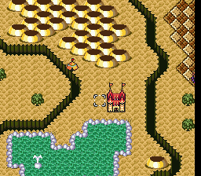
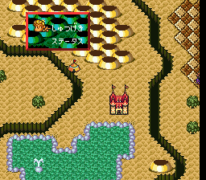

# 城の形状照合（v954）

自城5形状（全話共通）と敵城15形状（3区分×Lv1〜5）を認識器へ追加した。
収集済み30画像は校正資料として保持し、自城の微小な色差を別形状に数えない。

## 組み込み方

- `tools/hanjuku_compile_castles.py` が30画像とmanifestのSHAを確認し、
  20形状のRGBAと探索用アンカーを `castle_data.py` に生成する。
  runtimeはPython標準ライブラリのみ。ROM・Pillow・evalsディレクトリは不要。
- 旗のセル、透過色、地形セルを照合から除く。既存の方法で読めた自由カーソル・
  目標マーカーと明示されたexclude領域も無視する。隠れた画素は探索段階でも
  wildcardとし、見えない部分を根拠にレベルを確定しない。
- 色ごとのbit maskと4組の3点アンカーで候補を絞り、静止不透明画素の55%以上が
  見え、うち94%以上が各色成分±8内で一致した場合に形状として採用する。
  候補は1形状128位置まで。大量の単色候補は保留する。
- 同じ位置で陣営が競合する場合は保留。レベルの支持が拮抗する場合は
  `level=None` と候補レベルを返す。`score` は許容差内で一致した画素の割合であり、
  正解確率ではない。自城の `themes` は常に `(1,2,3)`。
- 大きな1城を複数に数えないよう、支持画素の多い形状を優先して重なりを除去する。
  戻り値には `source='sprite'`, `level`, `themes`, `score`, `sprite_box` を付ける。
- 既存 `castle_roofs` の呼び出し元にそのまま適用する。唯一の屋根が形状の
  下部中央からx±4/y±8内を指す場合は、既存の屋根bbox・選択座標を維持する。
  分割屋根・未検出・大きく外れた座標は、共通タイルキャンバスの `(24,40)` を使う。
- 形が読めない場合と画面端でキャンバスが欠ける場合は既存の屋根色判定へ戻る。
  色だけの結果にレベルを付けない。修理屋の屋根など、城以外に既存処理が
  利用している色検出も維持する。全ての色判定の誤検出を解消する変更ではない。

生成確認:

```sh
python3 tools/hanjuku_compile_castles.py --check
python3 -m pytest -q tests/test_hanjuku_castle_recognizer.py --basetemp=run-local/castle-tests
```

認識器と生成データをvision評価のソースSHA対象にも加えた。新しいworker/queueや
外部モデルは追加しない。診断のbot version許可一覧にv954を追加する。

## 校正と既存画面

`calibration.json` は前回と同じ条件（256×224、草地RGB=(8,112,16)、原点(100,80)、
旗あり、拡縮なし）で30画像を1枚ずつ合成した結果。
従来の「1件かつ陣営一致」は20/30、追加後は「1件かつ陣営・レベル一致」で30/30。
これは参照画像そのものを使う校正で、自然ランの認識精度ではない。

回帰テストでは30画像のRGB565/RGB888差、雪・砂漠色の背景、旗の消失、
自由カーソルと目標マーカーの遮蔽、2城同時表示、単色・崩した画像での保留も確認する。
既存の6話オケアナ画面は屋根bbox `(132,103,151,121)` と選択座標 `(141,122)` を維持。
3話パタゴーヌの画面は、旧処理の2件からLv5自城1件になった。
1城を2つの屋根として数えていた所有判定テストは、1城では所有変更しないことと、
独立した第2城がある場合には従来の敵旗による取り消しが働くことを両方確認する。
9話砂漠の画面は未検出からLv1自城1件になった。
リグアの目標マーカー画面では、カーソルが屋根を覆って旧判定が左に偏っていた
`(121,125)` から、Lv1形状の基準点 `(128,127)` へ補正する。
このため余計な左入力をやめ、下方向だけを補正する。移動回数上限は維持し、
確認距離の外なら到達扱いにしない。回帰テストは移動量・確認距離と実画面を区別する。

`local-timings.json` は共有Mac上で各画面3回、形状結果キャッシュを毎回消して測定した
中央値。既存画面5枚で従来35〜38ms、追加後52〜74ms（約17〜37ms増）。
同一画面の繰り返しでは形状照合結果を最大2件キャッシュするが、この測定には使わない。
VMのCPU負荷・観測間隔・実ゲームでの移動速度を測ったものではない。

## 入力座標のローカル確認

既存の9話マップセーブを隔離したSnes9xで読み、ROM・RAM・保存元セーブを
改変せず、新しいキャンバス基準点 `(144,127)` に短い方向入力で近づけた。
実測カーソル `(143,127)` からAを6 frames、解放90 framesで `castle_menu` に遷移した。
詳細は `native-anchor-check.json`。前後の原寸画面を保存する。

| 入力前 | A入力後 |
| --- | --- |
|  |  |

自然ラン、全レベルでの実入力、10〜12話の実画面とVM反映は未確認。
自己レビューと回帰テストの結果を、独立レビュー・本番での効果とは区別する。
