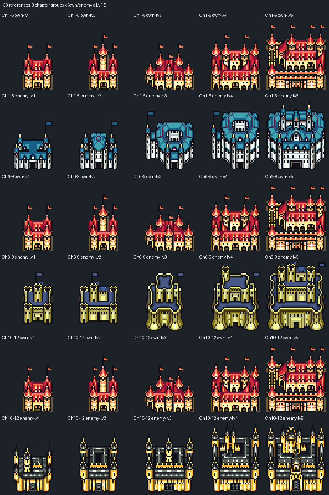

# 城画像リファレンス（30画像）

自城・敵城 × Lv1〜5 × 3つの話数区分。`manifest.json` の10クラスに各3見本、
合計30枚の透過PNGを収録する。各画像は拡大・補間なしの48×56ピクセル。
`overview.png` は目視確認用の一覧であり、31番目の学習見本には数えない。
自城の1〜5話と6〜9話は各レベルとも画素が同一であり、30ファイルのうち
異なるRGBA画像は25種類。話数区分を明示するため共通画像も別ファイルで保持する。
学習・評価を分ける際は、この同一画像を別の分割へ混在させない。
形状のパターン数は自城5種（全話共通）と敵城15種の合計20種。
認識器へはこの20種に統合して組み込み、自城の微小な配色差は色の許容差で扱う。

| 話数 | ファイル接頭辞 | 自城 | 敵城 |
| --- | --- | --- | --- |
| 1〜5話 | `ch01-05-` | Lv1〜5の5枚 | Lv1〜5の5枚 |
| 6〜9話 | `ch06-09-` | Lv1〜5の5枚 | Lv1〜5の5枚 |
| 10〜12話 | `ch10-12-` | Lv1〜5の5枚 | Lv1〜5の5枚 |



## 抽出元と再現

手元の日本語版ROMから城のタイル配置・4bpp画像・パレットを読み出した。
ROMやセーブデータは収録しない。対応するROM本体は1,048,576 bytes、SHA-256は
`59027382154fc0aefdb2fa84251b171cbf490bc5e013205a24e677122b446a24`。
512 bytesのcopier headerが付いている場合は、headerを除いた本体を照合する。
それ以外の版は誤抽出を避けるため拒否する。

```sh
# Pillowはrequirements-screen.txtに含まれる。出力先には未作成のディレクトリを指定。
python3 tools/hanjuku_collect_castles.py --rom /path/to/hanjuku-hero.sfc --output run-local/castles

# 収録した30画像とメタデータを、同じROMから書き込みなしで再照合。
python3 tools/hanjuku_collect_castles.py --rom /path/to/hanjuku-hero.sfc --output evals/hanjuku/castles --check
```

ROMファイルのoffset（headerを除く）:

- `0x07e45`: 話数ごとのテーマ番号。1〜5話=1、6〜9話=2、10〜12話=3。
- `0x0d93f`: 6×7タイルの配置42 bytes × 20パターン。
  自城5レベルは全テーマ共通、続いて敵城テーマ1・2・3がそれぞれ5レベル。
  配置byteの下位7 bitsがタイル番号、上位bitが左右反転。
- `0xc0000`: 自城21タイル。敵城は `0xc0380`（28）、`0xc0700`（30）、
  `0xc0ac0`（30タイル）。1タイル8×8、32 bytesのSNES 4bpp。
- `0xc0300` / `0xc0340`: 旗の2アニメーション。収録PNGは前者に固定。
  揺れる部分は各見本の `animated_flag_cells_xy` に記録する。
- `0xc38e0` / `0xc3ce0` / `0xc40e0`: テーマごとのpalette 7、各16色。
  自城にもテーマごとのパレットを適用する。自城で使う色はテーマ1・2間では同一、
  テーマ3では一部の暗色が変わる。

色はローカルSnes9xのRGB565キャプチャに合わせたRGB888値。
5bit成分を `r5<<3, (g5<<3)|((g5>>4)<<2), b5<<3` に投影する。
異なるキャプチャ経路のRGB888と比較する場合は、その量子化差を考慮する必要がある。

## 透明領域と検証の範囲

palette index 0と配置`0x7f`は透明。配置`0xff`は城の固定タイルではなく、
下の地形が残るセルなので、こちらも透明にして `terrain_cells_xy` に記録した。
背景を補って城の一部にしたり、透明画素のRGBを一致条件にしたりしない。
セル座標は左上基準の8×8タイル単位、画像座標とbboxはピクセル単位。

`verification/` の6画面は別枠の実描画・レベル確認用資料で、30枚には含めない。
隔離したローカルエミュレータの通常操作で取得した。1話は新規開始、9話は既存の
ローカルセーブを読み込んだ。取得時にROM・RAM・保存元セーブを改変していない。

| 画像 | レベルの確認 | 静止部分の画素照合 |
| --- | --- | --- |
| 1話の自城Lv2 | 城一覧のアルマムーン「2」 | 712/712一致、原点(120,87) |
| 9話の自城Lv1 | 城一覧のアルマムーン「1」 | 624/624一致、原点(120,87) |
| 1話の敵城Lv1 | ナキューメラ城ステータス「レベル1」 | 784/784一致、原点(104,71) |

旗セルを除いた不透明画素を、元の256×224キャプチャと完全一致で比較した。
PNGとRGBA画素のSHA-256、使用した配置・パレットoffsetはmanifestに記録する。
CIではROMなしで件数・ラベル・画素の整合性と、この3画面との一致を確認できる。

残りのレベルと10〜12話の対応はROMの配置テーブルから抽出したものであり、
30種類すべてを通常プレイの画面で照合したわけではない。テーマ3の実描画照合は未確認。
これは認識器の校正用データであり、自然ランにおける認識精度の評価セットではない。
カーソル・部隊・吹き出しによる遮蔽、画面端の欠け、配信映像の拡縮も含まれない。
この追加だけでは稼働中の認識処理は変更されない。
